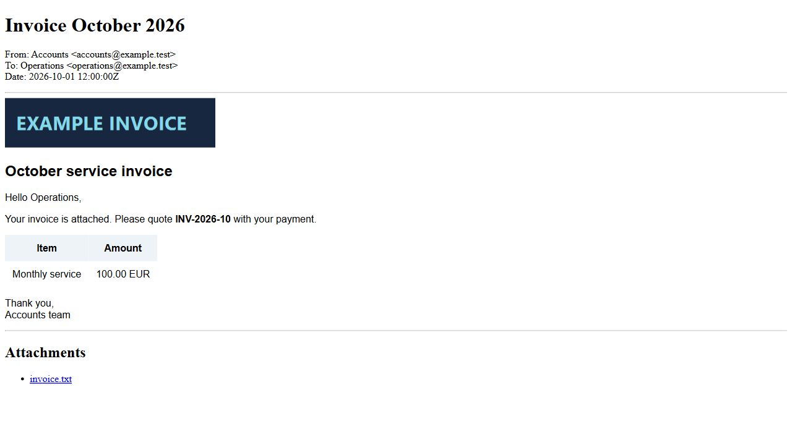

Sometimes the file I need is inside an old email archive. A customer sent a workbook, someone attached an invoice, or a useful screenshot is embedded in the message body. Before I can work with the document, I have to find the message and get its content out.

I want that job to look like ordinary PowerShell:

```powershell
$mail = Get-MailMessage -Path './Archive.pst' -SubjectContains 'invoice' -First 1
$mail.TextBody
$mail | Save-MailAttachment -Path './Invoices' -FileName '*.pdf'
```

Mailozaurr provides that flow for local email files and supported offline archives. The same message can be inspected, filtered, saved as a separate email, and exported as a readable HTML copy. The archive reader and format handling live in [OfficeIMO](https://github.com/EvotecIT/OfficeIMO); [Mailozaurr](https://github.com/EvotecIT/Mailozaurr) supplies the PowerShell commands. [PSWriteOffice](https://github.com/EvotecIT/PSWriteOffice) can then process the Office files you extract.

## Start with a local source

Install and import Mailozaurr:

```powershell
Install-Module Mailozaurr -Scope CurrentUser -Force
Import-Module Mailozaurr
```

These commands work in Windows PowerShell 5.1 and PowerShell 7. They read local files without requiring Outlook to be installed. Work from an offline copy of the source, particularly when it is an OST file used by an active Outlook profile.

Use the same command for a PST, a supported PST-compatible OST, or an individual EML or MSG file:

```powershell
$mail = Get-MailMessage './Archive.pst' -SubjectContains 'invoice' -First 1
$cachedMail = Get-MailMessage './Offline.ost' -First 1
$savedMail = Get-MailMessage './Message.msg' -First 1
$portableMail = Get-MailMessage './Message.eml' -First 1
```

The returned message includes bodies and attachment descriptions. The command closes its reader before returning, so there is no archive session to dispose for this basic flow. Later attachment and export commands reopen the source for the duration of their operation. Keep that source available and unchanged while using the message.

An OST is a local cache. It can contain incomplete messages or missing attachment content, and the reader cannot fetch missing data from Exchange. Check the reported availability:

```powershell
$cachedMail.ContentAvailability | Format-List *
```

Support for PST-compatible OST data does not mean that every OST variant, damaged archive, or protected message is readable. An export error needs investigation; it is not evidence that missing content was recovered.

## Find a message and read its body

For a more specific search, combine folder, sender, subject, and dates:

```powershell
$messages = Get-MailMessage -Path './Archive.pst' `
    -Folder 'Inbox' -Recurse `
    -SenderContains 'supplier@example.com' `
    -SubjectContains 'invoice' `
    -Since '2026-01-01' -Before '2026-02-01' `
    -First 25

$messages | Select-Object Subject, From, Date, FolderPath
```

`-Folder` accepts an exact folder path or a unique folder name. If several folders have the same name, use the full path reported in `FolderPath`. `-Recurse` includes that folder's descendants. Sender and subject fragments are case insensitive.

`-Since` is inclusive and `-Before` is exclusive. They use the received date when available and fall back to the sent date. `-First` limits matching messages in source order; it does not sort them by date. The default limit is 1,000 messages.

Read the body directly from a selected message:

```powershell
$mail = Get-MailMessage './Archive.pst' -SubjectContains 'invoice' -First 1

$mail | Select-Object Subject, From, To, Date, FolderPath | Format-List
$mail.TextBody
$mail.HtmlBody
$mail.RtfBody
```

Some messages only contain one body alternative. `HtmlBody` is the original body, so treat it as untrusted source content. Use the HTML export flow below when you want a sanitized local copy to open in a browser.

For large archives, `-MaxItemsScanned` limits how many summaries the search examines. When that limit stops the search, the command writes a warning. A partial search with no matches does not establish that the archive contains no matching message.

```powershell
Get-MailMessage './Archive.pst' -SubjectContains 'invoice' `
    -First 25 -MaxItemsScanned 50000
```

## Inspect attachments before saving them

`Get-MailAttachment` returns attachment descriptions. It does not write files:

```powershell
$mail | Get-MailAttachment |
    Select-Object FileName, ContentType, Size, IsInline, ContentId

$mail | Get-MailAttachment -FileName '*.pdf', '*.xlsx'
$mail | Get-MailAttachment -InlineOnly -ContentType 'image/*'
```

Filename and content-type filters accept wildcards. `-InlineOnly` is useful for logos, screenshots, and other images embedded in the body. Inline status comes from the source; an image attachment is not automatically marked inline simply because its media type starts with `image/`.

To select regular attachments, filter the descriptions explicitly:

```powershell
$attachments = $mail | Get-MailAttachment |
    Where-Object { -not $_.IsInline }
```

## Save selected files or embedded images

You can save directly from the message, or pipe selected attachment descriptions into the same command:

```powershell
$saved = $mail | Save-MailAttachment -Path './Extracted' `
    -FileName '*.pdf', '*.xlsx' -PassThru

$images = $mail | Get-MailAttachment -InlineOnly -ContentType 'image/*' |
    Save-MailAttachment -Path './Images' -PassThru

$attachments | Save-MailAttachment -Path './RegularAttachments'
```

Each message gets its own output folder by default. Saved filenames contain an ordinal, an identity hash, and a sanitized form of the original name. This handles untrusted filenames and gives files from different messages distinct destinations. Existing files are not overwritten.

Use `-PassThru` to get the saved path together with the original filename and source provenance:

```powershell
$saved | Select-Object OriginalFileName, Path, BytesWritten, Sha256, `
    SourcePath, FolderPath, MessageId
```

To save files from several messages into one directory, add `-Flatten`. The generated names retain a message identity even when subjects are long or repeated:

```powershell
Get-MailMessage './Archive.pst' -SubjectContains 'invoice' -First 50 |
    Save-MailAttachment './AllInvoices' -FileName '*.pdf' -Flatten -PassThru
```

Both saving and exporting support `-WhatIf`:

```powershell
$mail | Save-MailAttachment './Preview' -WhatIf
```

Extraction is bounded: the default shared policy permits up to 1,000 attachments, 64 MiB per attachment, and 256 MiB consumed by an operation. Missing content, write failures, and limits are reported. Files already saved successfully remain if a later attachment fails.

## Export an email you can use separately

The destination extension selects the format for a single message:

```powershell
$mail | Export-MailFile './Invoice.msg' -PassThru
$mail | Export-MailFile './Invoice.eml' -AllowLoss -PassThru
```

Native exports include attachment content. Some source metadata cannot be represented in another format. Conversion blocks those losses by default; `-AllowLoss` explicitly permits the conversion and reports the losses as warnings. Signed or encrypted content can have additional restrictions that this switch does not bypass.

For several messages, use an output directory and a format:

```powershell
Get-MailMessage './Archive.pst' -SubjectContains 'invoice' -First 50 |
    Export-MailFile -OutputDirectory './EmailCopies' `
        -Format Eml -AllowLoss -PassThru
```

Batch exports use source-specific names. A single `-Path` accepts one message; use `-OutputDirectory` for a pipeline containing several. Add `-Force` to replace an existing email copy.

The message view remains usable after saving or exporting, so you can perform several operations on the same `$mail` variable.

## Create a readable HTML copy with local images

For a browser-friendly copy, export HTML:

```powershell
$copy = $mail | Export-MailFile './Invoice.html' `
    -IncludeAttachments -PassThru

Invoke-Item $copy.FullName
```

HTML export selects the richest available body: HTML first, then an RTF projection, then encoded plain text. It removes active content and blocks remote resource references. Embedded images are saved locally, and their references are rewritten in image attributes, responsive image sources, and supported CSS URLs.

Embedded resources are included in HTML exports automatically. `-IncludeAttachments` also saves regular attachments and adds links to them beneath the body.



The HTML file has a companion directory such as `Invoice.assets-<unique-id>`. Keep the HTML and that directory together when moving the copy. Replacing an HTML file with `-Force` creates a fresh resource directory; earlier directories remain so an interrupted replacement cannot damage the earlier copy. Remove old directories when you no longer need them.

A readable HTML copy is useful for browsing and sharing. Keep the original archive or native email artifact when you need the original message structure, signatures, or format-specific metadata.

## Reuse an open store for several queries

When several selections use the same archive, `Invoke-MailStore` manages one reader around a script block:

```powershell
Invoke-MailStore './Archive.pst' {
    param($store)

    $invoices = $store | Get-MailMessage -SubjectContains 'invoice' -First 25
    $contracts = $store | Get-MailMessage -SubjectContains 'contract' -First 25

    $invoices | Save-MailAttachment './Invoices' -FileName '*.pdf'
    $contracts | Export-MailFile -OutputDirectory './Contracts' `
        -Format Html -IncludeAttachments
}
```

The scope closes the reader when the block finishes, including when the block throws. Queries reuse that reader; payload operations still open the source for their own duration. Messages returned from the block remain usable after the scope closes:

```powershell
$mail = Invoke-MailStore './Archive.pst' {
    param($store)
    $store | Get-MailMessage -SubjectContains 'invoice' -First 1
}

$mail | Save-MailAttachment './Extracted' -PassThru
```

Use `Import-MailData`, `Get-MailStoreFolder`, and the lower-level store commands when you need folder discovery, detailed diagnostics, content searching, or archive maintenance. The message flow above handles the common read-and-extract job without requiring explicit reader disposal.

## Pass the extracted files into PSWriteOffice

Mailozaurr gets files out of the message. PSWriteOffice can inspect or edit the extracted Office documents. For example, list the Excel tables defined in attached workbooks:

```powershell
Install-Module PSWriteOffice -Scope CurrentUser -Force
Import-Module PSWriteOffice

$workbooks = Get-MailMessage './Archive.pst' `
    -SubjectContains 'monthly report' -First 25 |
    Save-MailAttachment './Workbooks' -FileName '*.xlsx' -PassThru

foreach ($workbook in $workbooks) {
    Get-OfficeExcelTable -Path $workbook.Path |
        Select-Object Name, Sheet, Range
}
```

`Get-OfficeExcelTable` returns table definitions, so a workbook without defined tables produces no table records. The `Path` on each saved attachment is an ordinary local file path: use it with the appropriate Word, Excel, or PowerPoint command for the next part of your workflow.

This keeps the script close to the actual job: find the message, select its files, and work with the documents you need.
