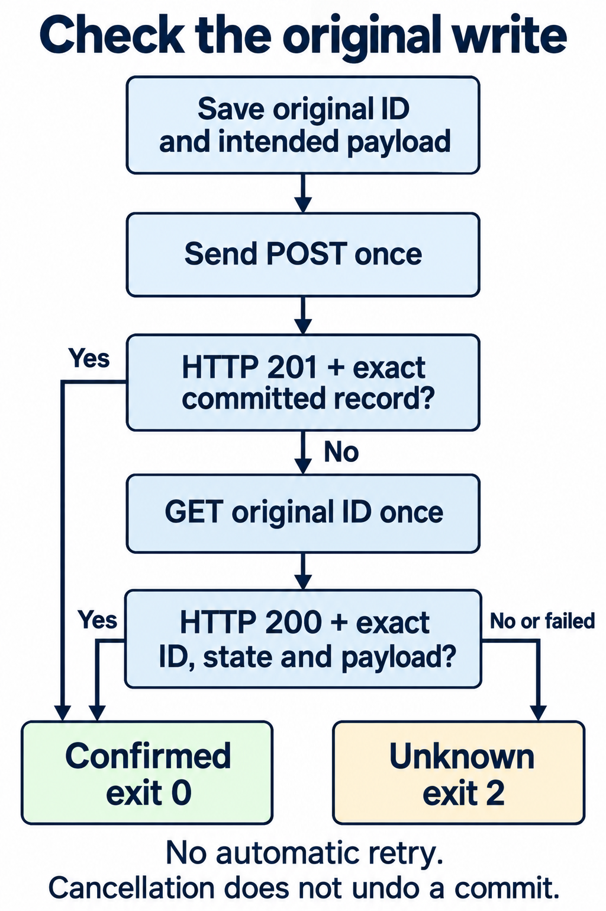

When a POST to save a schedule times out in `Invoke-WebRequest`, check the saved record before deciding whether to send the request again. This local lab uses the original operation ID for that check. After saving the server and client below, run `pwsh -NoProfile -File ./client.ps1`.

In the recorded `LostResponse` run, the API saved the schedule before PowerShell reported a timeout. Repeating the POST would have created another schedule. A GET with the original operation ID confirmed the saved write.

The API only stores configuration for a nightly inventory export; it doesn't run the export. Lost-response mode deliberately saves the schedule and withholds the response. You can compare the client result with the saved row, including cases where the client can't confirm an existing write.

## Confirm the write before continuing

An `Invoke-WebRequest` error describes what the client observed. The server may already have committed the write. [HTTP's idempotency rules](https://www.rfc-editor.org/rfc/rfc9110.html#section-9.2.2) explain why a communication failure alone doesn't justify repeating a non-idempotent request.

The client saves the operation ID and intended payload, then sends one POST. Only a `201` response containing that exact committed record confirms the write through the response.

If the POST doesn't confirm the write, the client makes one GET for the original ID. Only `200` with the exact record confirms success. Every other API result leaves the outcome unknown. The client never repeats the POST automatically. Stop any automation that depends on an unconfirmed write.

### Expected lost-response result



The client generates an operation ID by default. The recorded `LostResponse` run used a fixed ID and returned this complete object with exit `0`:

```json
{
  "Outcome": "ConfirmedSuccess",
  "ConfirmedBy": "Readback",
  "OperationId": "f42a9b21-54ed-42ca-b21c-1b8c134af001",
  "WriteStatus": null,
  "WriteError": "System.Threading.Tasks.TaskCanceledException: The request was canceled due to the configured HttpClient.Timeout of 3 seconds elapsing.",
  "ReadStatus": 200,
  "ReadError": null,
  "Reason": "ExactCommittedRecord"
}
```

The GET confirmed the saved schedule, while `WriteError` kept the POST timeout. An independent file check found the saved record while the client was still waiting. When it finished, the request journal held one POST and one GET; the schedule file held one exact record.

To reproduce the run, [start the API](#start-the-api-in-terminal-a), [save the complete client](#save-the-intent-in-terminal-b), then [check the result and saved schedule](#check-the-result-and-the-saved-schedule). A successful HTTP status alone doesn't confirm the write; the response must also pass the [record acceptance rules](#why-a-response-can-fail-the-record-check).

## Start the API in terminal A

Use PowerShell 7.6, two terminals, a writable directory, and free loopback port `8765`. The lab runs locally and needs no modules or credentials.

The lab was run programmatically on macOS 26.3.2 ARM64 with PowerShell 7.6.9 and .NET 10.0.14. All six scenarios also matched the expected results on Windows with PowerShell 7.6.9. Linux, Windows PowerShell 5.1, and the interactive two-terminal walkthrough were not tested.

In terminal A, start PowerShell:

```powershell
pwsh -NoProfile
```

At the new PowerShell prompt, create the lab folder:

```powershell
$PSVersionTable.PSVersion
New-Item -ItemType Directory -Path './api outcome lab'
Set-Location -LiteralPath './api outcome lab'
(Get-Location).Path
```

`Receive-Request` records each request in `requests.jsonl`. `Save-Schedule` appends the new schedule to `schedules.jsonl` before handling the response. The schedule can remain saved even if the response fails.

In `LostResponse`, `Hold-Response` keeps the unanswered HTTP context in memory while the listener accepts more requests. The client's GET can then reach `Read-Operation` and retrieve the saved schedule while the POST remains unanswered.

Save the complete server listing as `server.ps1` in that folder:

```powershell
param(
    [Parameter(Mandatory)][string]$RunDirectory,
    [ValidateSet('Normal', 'LostResponse', 'ReadbackUnavailable', 'ReadbackMissing',
        'ReadbackMismatch', 'ReadbackLost')][string]$Scenario = 'LostResponse',
    [ValidateRange(1024, 65535)][int]$Port = 8765
)
$ErrorActionPreference = 'Stop'
Set-StrictMode -Version Latest

function Send-Json($Context, [int]$Status, $Value) {
    $bytes = [Text.Encoding]::UTF8.GetBytes(($Value | ConvertTo-Json -Depth 6 -Compress))
    $Context.Response.StatusCode = $Status
    $Context.Response.ContentType = 'application/json; charset=utf-8'
    $Context.Response.ContentLength64 = $bytes.Length
    $Context.Response.OutputStream.Write($bytes, 0, $bytes.Length)
    $Context.Response.Close()
}

function Hold-Response($Context) {
    if ($held.Count -ge 8) { throw 'Eight held responses reached. Stop this lab run.' }
    $held.Add($Context)
}

function Save-Schedule($Context, [string]$Body) {
    $request = $Body | ConvertFrom-Json
    $record = [ordered]@{
        operationId = $request.operationId
        state = 'committed'
        payload = $request.payload
    }
    $line = $record | ConvertTo-Json -Depth 6 -Compress
    [IO.File]::AppendAllText($schedulePath, $line + "`n")
    $saved.Add($record)
    if ($Scenario -eq 'Normal') {
        Send-Json $Context 201 $record
        return
    }
    Hold-Response $Context
}

function Read-Operation($Context, [string]$Id) {
    if ($Scenario -eq 'ReadbackLost') { Hold-Response $Context; return }
    if ($Scenario -eq 'ReadbackUnavailable') { Send-Json $Context 503 @{}; return }
    if ($Scenario -eq 'ReadbackMissing') { Send-Json $Context 404 @{}; return }
    $matches = @($saved | Where-Object { $_.operationId -ceq $Id })
    if ($matches.Count -eq 0) { Send-Json $Context 404 @{}; return }
    if ($matches.Count -ne 1) { Send-Json $Context 409 @{}; return }
    $record = $matches[0] | ConvertTo-Json -Depth 6 | ConvertFrom-Json
    if ($Scenario -eq 'ReadbackMismatch') { $record.payload.timeUtc = '03:30' }
    Send-Json $Context 200 $record
}

function Receive-Request($Context) {
    $reader = [IO.StreamReader]::new($Context.Request.InputStream, [Text.Encoding]::UTF8)
    try { $body = $reader.ReadToEnd() } finally { $reader.Dispose() }
    $method = $Context.Request.HttpMethod
    $path = $Context.Request.RawUrl
    $entry = @{ method = $method; path = $path; body = $body } | ConvertTo-Json -Compress
    [IO.File]::AppendAllText($requestPath, $entry + "`n")
    if ($method -ceq 'POST' -and $path -ceq '/schedules') {
        Save-Schedule $Context $body
        return
    }
    if ($method -ceq 'GET' -and $path.StartsWith('/operations/', [StringComparison]::Ordinal)) {
        Read-Operation $Context $path.Substring(12)
        return
    }
    Send-Json $Context 404 @{}
}

$directory = New-Item -ItemType Directory -Path $RunDirectory
$schedulePath = Join-Path $directory.FullName 'schedules.jsonl'
$requestPath = Join-Path $directory.FullName 'requests.jsonl'
$saved = [Collections.Generic.List[object]]::new()
$held = [Collections.Generic.List[object]]::new()
$listener = [Net.HttpListener]::new()
$listener.Prefixes.Add("http://127.0.0.1:$Port/")
try {
    $listener.Start()
    Write-Output "READY http://127.0.0.1:$Port/ $Scenario"
    while ($listener.IsListening) {
        $pending = $listener.GetContextAsync()
        while (-not $pending.Wait(100)) { }
        Receive-Request $pending.GetAwaiter().GetResult()
    }
} finally {
    foreach ($context in $held) { $context.Response.Abort() }
    $listener.Close()
}
```

Start the server in the foreground:

```powershell
pwsh -NoProfile -File ./server.ps1 -RunDirectory './run-lost' -Scenario LostResponse
```

Wait for `READY http://127.0.0.1:8765/ LostResponse` before starting the client. Startup fails if the run directory already exists or the port is busy. Use a fresh run directory for each scenario.

The server holds up to eight responses; the next attempted hold throws. A POST that reaches this limit has already appended its schedule, and the error doesn't undo that write. This boundary hasn't been runtime tested.

## Save the intent in terminal B

Open a second terminal in the parent directory of the lab folder. Start PowerShell:

```powershell
pwsh -NoProfile
```

At the new PowerShell prompt, select the lab folder:

```powershell
Set-Location -LiteralPath './api outcome lab'
```

The top-level `$id` and `$intent` block builds the operation ID and payload, then encodes them as UTF-8. It opens `$IntentPath` with `[IO.FileMode]::CreateNew`, writes the intent, and closes the file before any network request. Both confirmation paths use this saved intent.

The default filename is `intent.json`. If it already exists, the client stops before sending anything. Rerunning the client won't automatically resume or resend an earlier intent.

A confirmed response or readback produces the full `ConfirmedSuccess` object and exit `0`. If a completed API check can't confirm the write, it returns `Unknown` and exit `2`. Stop automation that depends on the write.

Save the complete listing as `client.ps1` in the lab folder:

```powershell
param(
    [ValidateRange(1024, 65535)][int]$Port = 8765,
    [guid]$OperationId = [guid]::NewGuid(),
    [string]$IntentPath = './intent.json'
)
$ErrorActionPreference = 'Stop'
Set-StrictMode -Version Latest

function Get-JsonString($Value) {
    if ($Value -is [Text.Json.JsonElement]) {
        if ($Value.get_ValueKind().ToString() -ne 'String') { throw 'Expected a JSON string element' }
    } elseif ($Value -isnot [Text.Json.JsonProperty]) {
        throw 'Expected a JSON string element or property'
    }
    try {
        if ($Value -is [Text.Json.JsonProperty]) { return $Value.get_Name() }
        return $Value.GetString()
    } catch [ObjectDisposedException] { throw }
    catch [InvalidOperationException] {
        throw [Text.DecoderFallbackException]::new('Cannot decode provider JSON string.', $_.Exception)
    }
}

function Test-Fields($Element, [string[]]$Names) {
    if ($Element.ValueKind.ToString() -ne 'Object') { return $false }
    $expected = [Collections.Generic.HashSet[string]]::new($Names, [StringComparer]::Ordinal)
    $seen = [Collections.Generic.HashSet[string]]::new([StringComparer]::Ordinal)
    foreach ($property in $Element.EnumerateObject()) {
        $name = Get-JsonString $property
        if (-not $expected.Contains($name)) { return $false }
        if (-not $seen.Add($name)) { return $false }
    }
    return $seen.Count -eq $Names.Count
}

function Test-StringFields($Element, [string[]]$Names) {
    foreach ($name in $Names) {
        if ($Element.GetProperty($name).ValueKind.ToString() -ne 'String') { return $false }
    }
    return $true
}

function Get-RecordReason($Record) {
    if (-not (Test-Fields $Record @('operationId', 'state', 'payload'))) { return 'InvalidShape' }
    if (-not (Test-StringFields $Record @('operationId', 'state'))) { return 'InvalidShape' }
    $payload = $Record.GetProperty('payload')
    if (-not (Test-Fields $payload @('task', 'timeUtc', 'enabled'))) { return 'InvalidShape' }
    if (-not (Test-StringFields $payload @('task', 'timeUtc'))) { return 'InvalidShape' }
    if ($payload.GetProperty('enabled').ValueKind.ToString() -notin @('True', 'False')) {
        return 'InvalidShape'
    }
    $actual = @((Get-JsonString ($Record.GetProperty('operationId'))), (Get-JsonString ($Record.GetProperty('state'))),
        (Get-JsonString ($payload.GetProperty('task'))), (Get-JsonString ($payload.GetProperty('timeUtc'))))
    $expected = @($id, 'committed', $intent.payload.task, $intent.payload.timeUtc)
    for ($i = 0; $i -lt $expected.Count; $i++) {
        if (-not [string]::Equals($actual[$i], $expected[$i], [StringComparison]::Ordinal)) {
            return 'RecordMismatch'
        }
    }
    if ($payload.GetProperty('enabled').GetBoolean() -ne $intent.payload.enabled) { return 'RecordMismatch' }
    return 'ExactCommittedRecord'
}

function Get-ResponseReason($Response, [int]$ExpectedStatus) {
    if ($null -eq $Response) { return 'TransportError' }
    if ([int]$Response.StatusCode -ne $ExpectedStatus) { return "HttpStatus:$($Response.StatusCode)" }
    try { $document = [Text.Json.JsonDocument]::Parse([string]$Response.Content) }
    catch [Text.Json.JsonException] { return 'InvalidJson' }
    try { return Get-RecordReason $document.RootElement }
    catch [Text.DecoderFallbackException] { return 'UndecodableString' }
    finally { $document.Dispose() }
}

function Get-RequestError($Failure) {
    $exception = $Failure.Exception
    $detail = "$($exception.GetType().FullName): $($exception.Message)"
    if ($Failure.FullyQualifiedErrorId -like 'MaximumRedirectExceeded,*') {
        return "$detail $($Failure.ErrorDetails.Message)"
    }
    foreach ($type in @([Net.Http.HttpRequestException], [Threading.Tasks.TaskCanceledException], [TimeoutException])) {
        if ($exception -is $type) { return $detail }
    }
    throw $Failure
}

$id = $OperationId.ToString('D')
$intent = @{ operationId = $id; payload = @{ task = 'inventory-export'; timeUtc = '02:30'; enabled = $true } }
$json = $intent | ConvertTo-Json -Depth 4
$bytes = [Text.Encoding]::UTF8.GetBytes($json)
$file = [IO.File]::Open($IntentPath, [IO.FileMode]::CreateNew)
try { $file.Write($bytes, 0, $bytes.Length) } finally { $file.Dispose() }
$options = @{
    MaximumRetryCount = 0
    MaximumRedirection = 0
    ConnectionTimeoutSeconds = 3
    OperationTimeoutSeconds = 3
    HttpVersion = '1.1'
    DisableKeepAlive = $true
    NoProxy = $true
    SkipHttpErrorCheck = $true
    ErrorAction = 'Stop'
}
$result = [ordered]@{
    Outcome = 'Unknown'; ConfirmedBy = $null; OperationId = $id
    WriteStatus = $null; WriteError = $null; ReadStatus = $null; ReadError = $null; Reason = $null
}
$write = $null
try {
    Invoke-WebRequest @options -Uri "http://127.0.0.1:$Port/schedules" -Method Post `
        -Body $bytes -ContentType 'application/json; charset=utf-8' | ForEach-Object {
            $write = $_
            $result.WriteStatus = [int]$_.StatusCode
        }
} catch {
    $result.WriteError = Get-RequestError $_
}
$result.Reason = Get-ResponseReason $write 201
if ($result.Reason -eq 'ExactCommittedRecord') {
    $result.ConfirmedBy = 'Response'
} else {
    $read = $null
    try {
        Invoke-WebRequest @options -Uri "http://127.0.0.1:$Port/operations/$id" -Method Get | ForEach-Object {
            $read = $_
            $result.ReadStatus = [int]$_.StatusCode
        }
    } catch {
        $result.ReadError = Get-RequestError $_
    }
    $result.Reason = Get-ResponseReason $read 200
    if ($result.Reason -eq 'ExactCommittedRecord') { $result.ConfirmedBy = 'Readback' }
}
if ($null -ne $result.ConfirmedBy) {
    $result.Outcome = 'ConfirmedSuccess'
    [pscustomobject]$result | ConvertTo-Json
    exit 0
}
[pscustomobject]$result | ConvertTo-Json
exit 2
```

One `Invoke-WebRequest` POST sends the saved bytes. If the request throws, `Get-RequestError` keeps the native exception type and message for expected transport failures. It rethrows unexpected local errors. A timeout tells you what the client observed; the server may still have saved the schedule.

`Get-ResponseReason $write 201` first requires status `201`. It then calls `Get-RecordReason` to compare the response with the intent. The original ID, state `committed`, and intended payload must all match to return `ExactCommittedRecord`. A different record can't confirm this write, even with status `201`.

If the response doesn't confirm the write, the client makes one GET to `/operations/$id` using the original ID. `Get-ResponseReason $read 200` requires status `200` and an exact match for the expected record. This readback can confirm the saved write without another POST or a new operation ID.

The [web-command timeout settings](https://learn.microsoft.com/en-us/powershell/module/microsoft.powershell.utility/invoke-webrequest?view=powershell-7.6#-connectiontimeoutseconds) limit different waits. `ConnectionTimeoutSeconds` bounds a pending request; `OperationTimeoutSeconds` limits a stalled stream read. Both are three seconds here. Neither limits the whole script's runtime or tells the server to roll back. Status-based retries and redirects are disabled.

`SkipHttpErrorCheck` lets the client inspect an HTTP error response without throwing on its status. Confirmation still requires the expected status and exact record. See [PowerShell's terminating-error handling](https://learn.microsoft.com/en-us/powershell/module/microsoft.powershell.core/about/about_try_catch_finally?view=powershell-7.6) for how request errors reach `catch` and `Get-RequestError`.

## Check the result and the saved schedule

Run the client once in terminal B, then inspect its result and both server files:

```powershell
pwsh -NoProfile -File ./client.ps1
$clientExit = $LASTEXITCODE
"Client exit: $clientExit"
$intent = Get-Content -LiteralPath './intent.json' -Raw | ConvertFrom-Json
Get-Content -LiteralPath './run-lost/schedules.jsonl' | ConvertFrom-Json | Format-List
Get-Content -LiteralPath './run-lost/requests.jsonl' | ConvertFrom-Json | Select-Object method, path
```

Compare your result with the [complete lost-response result below the diagram](#expected-lost-response-result). Before automation accepts success, require a completed invocation with the full `ConfirmedSuccess` object for the original operation ID and native exit `0`. Exit `0` alone isn't enough.

Compare the server files with `intent.json`. Count requests and saved rows separately: `ConfirmedSuccess` doesn't tell you how many schedules were created. This run should have one POST to `/schedules` and one GET to `/operations/` followed by the original `$intent.operationId`. The saved record must contain that ID, state `committed`, and payload values `task: inventory-export`, `timeUtc: 02:30`, and Boolean `enabled: true`.

## A saved row can coexist with a 404

In `ReadbackMissing`, the server saves the exact schedule but returns `404` to the client's GET. Start a fresh run to inspect the saved row alongside the client result.

Stop the server with Ctrl+C in terminal A. The `finally` block closes the listener and held responses. The files remain available to inspect. Start the missing-readback scenario:

```powershell
pwsh -NoProfile -File ./server.ps1 -RunDirectory './run-missing' -Scenario ReadbackMissing
```

Run the client once in terminal B with a new intent filename:

```powershell
pwsh -NoProfile -File ./client.ps1 -IntentPath './intent-missing.json'
$LASTEXITCODE
Get-Content -LiteralPath './run-missing/schedules.jsonl'
```

The recorded client result was `Unknown`, `ReadStatus: 404`, `Reason: HttpStatus:404`, and exit `2`. The schedule file still held the exact saved record. The lab hides that record from the read path, so its `404` doesn't establish rollback.

Before treating a missing record as evidence that no write occurred, check the API's documented read consistency and operation-retention guarantees.

All six recorded runs saved one row. The client stayed at `Unknown` when the GET returned `503`, `404`, a `200` record with the wrong time, or no response before timeout. Stop the server and use a fresh run directory and intent filename for each additional scenario.

Counts are POST / GET / saved rows.

| Scenario | POST | GET | Outcome / exit | Counts |
|---|---|---|---|---|
| `Normal` | Exact `201` | Not requested | Confirmed by response / `0` | 1 / 0 / 1 |
| `LostResponse` | Timeout | Exact `200` | Confirmed by readback / `0` | 1 / 1 / 1 |
| `ReadbackUnavailable` | Timeout | `503` | Unknown / `2` | 1 / 1 / 1 |
| `ReadbackMissing` | Timeout | `404` | Unknown / `2` | 1 / 1 / 1 |
| `ReadbackMismatch` | Timeout | `200`, wrong time | Unknown / `2` | 1 / 1 / 1 |
| `ReadbackLost` | Timeout | Timeout | Unknown / `2` | 1 / 1 / 1 |

The `ReadbackLost` run exited with code `2` and returned this object.

```json
{
  "Outcome": "Unknown",
  "ConfirmedBy": null,
  "OperationId": "f42a9b21-54ed-42ca-b21c-1b8c134af001",
  "WriteStatus": null,
  "WriteError": "System.Threading.Tasks.TaskCanceledException: The request was canceled due to the configured HttpClient.Timeout of 3 seconds elapsing.",
  "ReadStatus": null,
  "ReadError": "System.Threading.Tasks.TaskCanceledException: The request was canceled due to the configured HttpClient.Timeout of 3 seconds elapsing.",
  "Reason": "TransportError"
}
```

`Reason` reports `ExactCommittedRecord` or the check that failed: HTTP status, transport failure, invalid JSON, an undecodable string, invalid shape, or record mismatch. `WriteError` and `ReadError` keep the exception diagnostics. An unhandled local or script-terminating error exits `1`. A completed `Unknown` API result exits `2`.

Cancellation can stop the client before it emits a complete result without undoing the server commit. Microsoft documents [Ctrl+C exit `0` for `pwsh -File`](https://learn.microsoft.com/en-us/powershell/module/microsoft.powershell.core/about/about_pwsh?view=powershell-7.6#-file--f), so a missing or incomplete result leaves the write uncertain even with exit `0`. This client has no cancellation-triggered GET in `finally`. Fresh cancellation wasn't measured here; behavior across hosts and termination mechanisms remains unverified.

## Why a response can fail the record check

### Confirming the wrong operation or schedule

`Get-RecordReason` checks the operation and its saved values. A different operation ID belongs to another write. A schedule for `03:30` doesn't match the intended `02:30`. The record must say `committed` and match the original task and enabled value.

`Test-StringFields` requires JSON strings for `operationId`, `state`, `task`, and `timeUtc`. `Get-JsonString` decodes them for comparison with the original ID, `committed`, and the saved task and time. `enabled` must be a JSON Boolean equal to the intended `true`. The JSON string `"true"` fails.

Decoded property names and string values must match exactly, including case. The checks use culture-independent ordinal equality. Equivalent string escaping, property order, and whitespace can vary. Ordinary [PowerShell comparisons](https://learn.microsoft.com/en-us/powershell/module/microsoft.powershell.core/about/about_comparison_operators?view=powershell-7.6) may coerce values or ignore case; these checks allow neither.

### Accepting missing or ambiguous fields

The client inspects fields with [JsonDocument](https://learn.microsoft.com/en-us/dotnet/standard/serialization/system-text-json/use-dom#use-jsondocument) before comparing values. `Test-Fields` requires exactly `operationId`, `state`, and `payload` in the root object, and exactly `task`, `timeUtc`, and `enabled` in the payload object.

Each field must occur once in its object. Missing, extra, or duplicate fields fail. A one-element array in place of either object also fails. The client won't confirm an incomplete record or choose between duplicate values.

### Accepting a string that cannot be decoded

.NET can parse JSON before decoding every property name or string value. `Get-JsonString` checks the local type before decoding. An unescape error during that later step can still prevent the response from confirming the write.

`Get-ResponseReason` reports this decoding failure as `UndecodableString`. If the `201` response fails this check, the client makes its one GET for the original ID. A `200` with the exact committed record can still confirm the write. An undecodable `200` readback leaves `Unknown`. Wrong local types, disposed objects, and unexpected errors still throw; they don't become uncertain API results.

## Repeat the POST deliberately

Stop the previous server, then start `Normal` in terminal A:

```powershell
pwsh -NoProfile -File ./server.ps1 -RunDirectory './run-normal' -Scenario Normal
```

Create one schedule in terminal B:

```powershell
pwsh -NoProfile -File ./client.ps1 -IntentPath './intent-normal.json'
$LASTEXITCODE
```

Explicitly repeat the saved request once:

```powershell
$ErrorActionPreference = 'Stop'
$intent = Get-Content -LiteralPath './intent-normal.json' -Raw | ConvertFrom-Json
$body = Get-Content -LiteralPath './intent-normal.json' -Raw
$options = @{
    MaximumRetryCount = 0; MaximumRedirection = 0
    ConnectionTimeoutSeconds = 3; OperationTimeoutSeconds = 3
    HttpVersion = '1.1'; DisableKeepAlive = $true; NoProxy = $true
    SkipHttpErrorCheck = $true; ErrorAction = 'Stop'
}
$repeat = Invoke-WebRequest @options -Uri 'http://127.0.0.1:8765/schedules' -Method Post `
    -Body ([Text.Encoding]::UTF8.GetBytes($body)) -ContentType 'application/json; charset=utf-8'
$lookup = Invoke-WebRequest @options -Uri "http://127.0.0.1:8765/operations/$($intent.operationId)"
[pscustomobject]@{ RepeatStatus = [int]$repeat.StatusCode; LookupStatus = [int]$lookup.StatusCode }
@(Get-Content -LiteralPath './run-normal/schedules.jsonl').Count
```

The recorded repeat produced:

```text

RepeatStatus LookupStatus
------------ ------------
         201          409
2

```

The second POST returned `201` and added a second exact row. With two records for the same ID, the GET returned `409` instead of choosing one. The operation ID connects the requests to their records, but this server doesn't prevent duplicates.

Before retrying a production POST, check the server's documented key scope and how it binds the key to the payload. Duplicate handling must be atomic with the business effect. Check conflicting payloads, concurrent requests, key retention, and the lookup's read consistency. The server can ignore `Idempotency-Key`, so adding the header alone doesn't make a retry safe.

This listener is a teaching fixture with no authentication, concurrent business-write handling, or database transactions. The read index and held responses stay in memory. The JSON-lines files survive an ordinary stop, but the server doesn't reload them on restart. It doesn't guarantee crash consistency or power-loss durability.

If readback leaves the write unknown, keep the intent and result and stop automation that depends on the write. Check the original operation through the API's documented read path before deciding whether to send another POST.
